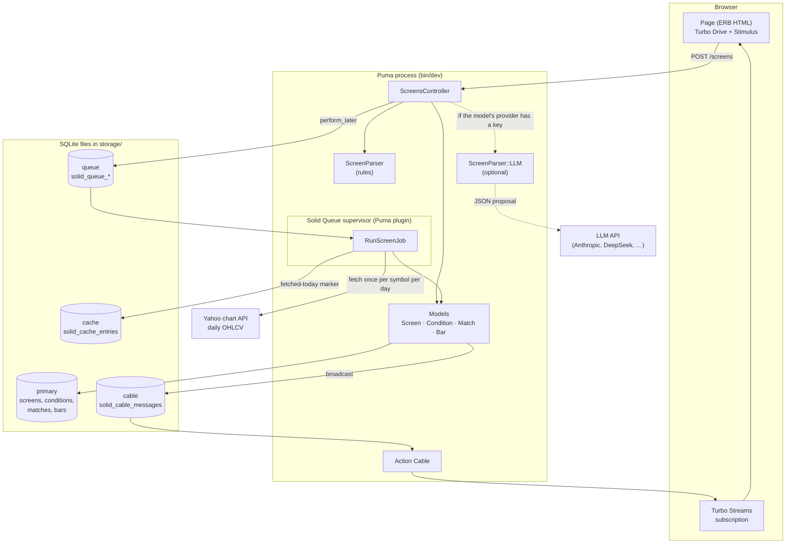
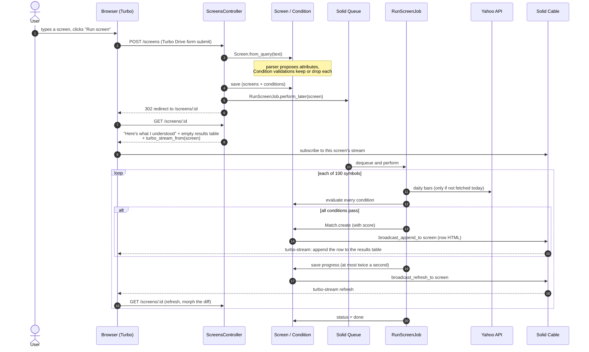
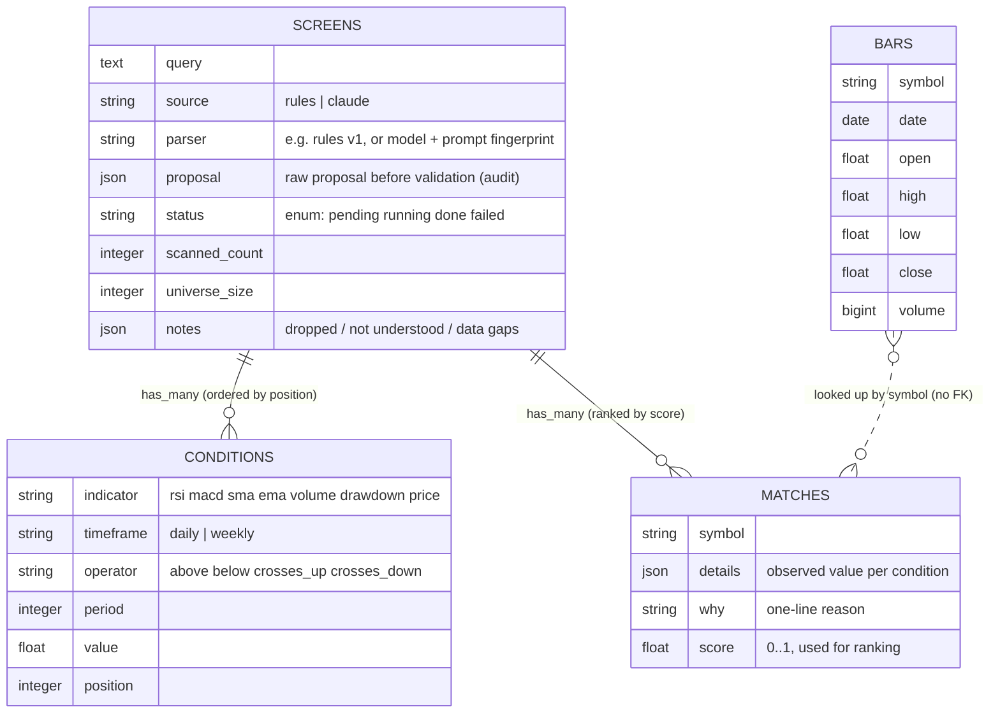
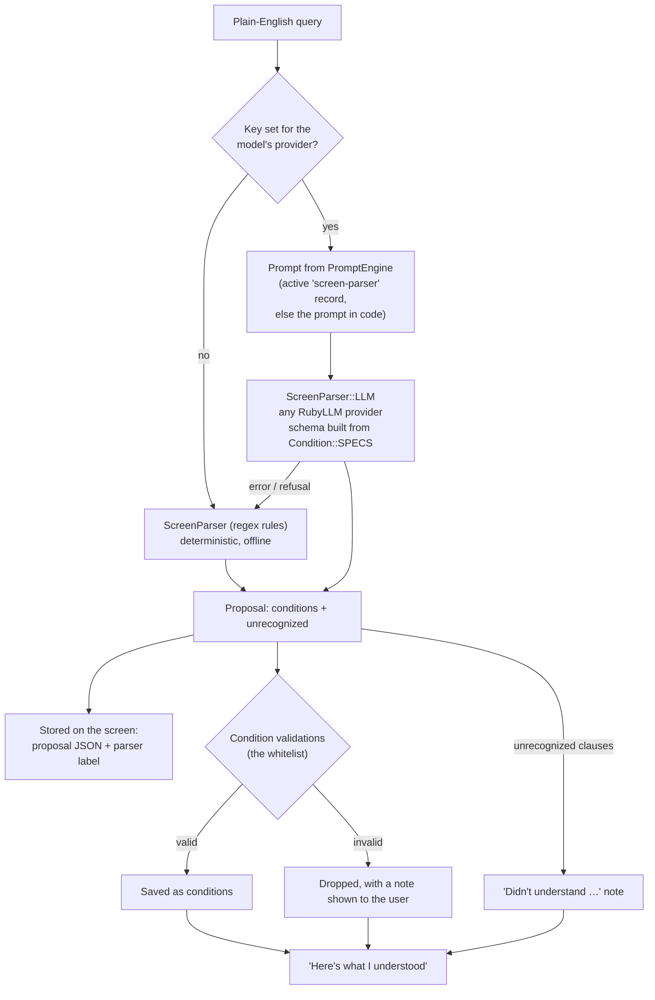
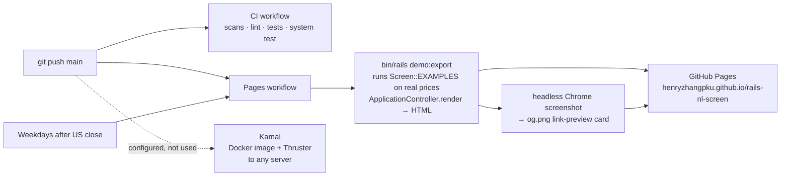
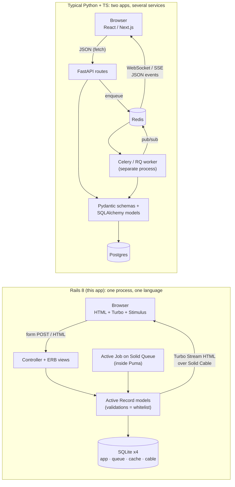

# Study notes: re-learning Rails through one small app

*Henry Zhang. I last used Rails around 2007 (Rails 1.2/2.0: Prototype, RJS, `script/generate`, Mongrel,
Capistrano). These notes walk through how the Rails 8 stack is used in one small, real app, layer by layer,
with a short "In 2007 / Now" note in each section and exercises at the end.*

## The app these notes are about

NL Screen turns a plain-English stock screen ("RSI(14) under 30, MACD crossing up, price above the 200-day
moving average") into typed, whitelisted conditions, runs them over 100 large US stocks on daily prices, and
streams ranked matches into the page as they're found.

It is deliberately a *default* Rails 8 application: one process, SQLite everywhere, no Redis, no Node build,
no front-end framework. Each section below covers one layer: which Rails piece does the work, where it lives
in the code, and why it was chosen.

Suggested reading order for the code: `config/routes.rb` → `app/controllers/screens_controller.rb` →
`app/models/screen.rb` → `app/models/condition.rb` → `app/models/screen_parser.rb` →
`app/models/indicators.rb` → `app/models/match.rb` → `app/views/screens/show.html.erb`.

- Live static demo: https://henryzhangpku.github.io/rails-nl-screen/
- Code: https://github.com/henryzhangpku/rails-nl-screen

---

## 1. The stack at a glance

| Layer | Rails 8 piece | Where in the code |
|---|---|---|
| Web server | Puma (+ Thruster in production) | `config/puma.rb`, `Dockerfile` |
| Routing / HTTP | `resources :screens`, one controller | `config/routes.rb`, `app/controllers/screens_controller.rb` |
| Sign-in | Rails 8 **authentication generator** (`has_secure_password`, a `Session` model, signed cookie) | `app/controllers/concerns/authentication.rb`, `app/models/session.rb` |
| Engines | **PromptEngine** mounted at `/prompts`: the LLM prompt as versioned data, behind sign-in | `config/routes.rb`, `db/seeds.rb` |
| Domain logic | Active Record models and plain Ruby objects, autoloaded by Zeitwerk | `app/models/*` |
| Persistence | SQLite via Active Record, 4 databases | `config/database.yml`, `db/migrate/*` |
| Background work | Active Job on **Solid Queue**, run inside Puma | `app/jobs/run_screen_job.rb`, `config/queue.yml` |
| Caching | **Solid Cache** (cache entries in a SQLite table) | `app/models/bar.rb`, `config/cache.yml` |
| Real-time | Action Cable on **Solid Cable**, Turbo Streams and Turbo 8 page refreshes | `app/models/match.rb`, `app/models/screen.rb`, `config/cable.yml` |
| Front end | Hotwire: Turbo Drive, Turbo Streams, one Stimulus controller | `app/views/**`, `app/javascript/controllers/examples_controller.js` |
| JavaScript delivery | **Importmaps** (no bundler, no `node_modules`) | `config/importmap.rb` |
| CSS / assets | **Propshaft** serving plain CSS, one file per component, BEM names (`ns-` prefix) | `app/assets/stylesheets/*.css` |
| External APIs | Net::HTTP (Yahoo chart API), **RubyLLM** (optional; any provider: Anthropic, DeepSeek, OpenAI, Gemini…) | `app/models/market_data/yahoo.rb`, `app/models/screen_parser/llm.rb` |
| Tests | **RSpec** (rspec-rails), FactoryBot, WebMock; system specs with **Cuprite** (headless Chrome over CDP) | `spec/**` |
| CI | GitHub Actions: Brakeman, bundler-audit, importmap audit, RuboCop, tests | `.github/workflows/ci.yml` |
| Dev tooling | **annotaterb** (schema comments at the top of each model), **rails_live_reload** (browser refreshes on save) | `.annotaterb.yml`, `lib/tasks/annotate_rb.rake` |
| Static demo | Rake task + `ApplicationController.render` + GitHub Pages | `lib/tasks/demo.rake`, `.github/workflows/pages.yml` |
| Deployment (configured) | **Kamal** + Docker | `config/deploy.yml`, `.kamal/` |

---

## 2. System overview



Everything inside the Puma box is one OS process tree started by `bin/dev`. The four SQLite files replace
what used to be Postgres + Redis + Memcached + a Sidekiq process.

---

## 3. A request, end to end

> **In 2007** the form would post, the controller would redirect, and any "live" update meant `periodically_call_remote` polling with RJS. **Now** the redirect is the same, but updates are pushed from the server over a WebSocket as HTML fragments.



Steps 13–19 are where Hotwire does its work: the server renders HTML fragments and pushes them; the browser
never parses JSON or holds application state.

---

## 4. Data model

> **In 2007** status was a string column plus constants, structured data went into YAML `serialize` columns, and bulk inserts were a loop of `save`. **Now**: `enum`, native JSON columns, `upsert_all`, and `null: false` constraints generated by the migration DSL.



Rails features this exercises:

- **Associations with scopes**: `has_many :matches, -> { order(score: :desc, id: :asc) }` makes "ranked" the
  default everywhere, including in the static demo.
- **`enum :status`** with string values gives `screen.done?`, `screen.running!` and `Screen.failed` for free.
- **JSON columns** (`notes`, `proposal`, `details`) for small structured blobs that are never queried.
- **Constraints in the database, not just the model**: `null: false`, defaults, and a unique index on
  `bars (symbol, date)`, which is what makes `upsert_all` idempotent.
- **`upsert_all`**: one statement inserts or updates two years of bars for a symbol.

---

## 5. The domain layer: "it's all in `app/models`"

> **In 2007** `lib/` plus `require` statements, and `const_missing` magic that broke in surprising ways. **Now** Zeitwerk maps file paths to constants, so a plain Ruby module dropped into `app/models/` just works, in development and with eager loading in production.

Rails' omakase answer to "where does business logic go?" is the models directory. Nothing here is a
"service object" folder; plain Ruby objects sit next to Active Record models, and **Zeitwerk** loads them
by file name (`app/models/market_data/yahoo.rb` ⇒ `MarketData::Yahoo`).

| Object | Kind | Job |
|---|---|---|
| `Screen` | Active Record | Owns the query, builds itself from text (`from_query`), runs the scan (`run`), broadcasts progress. |
| `Condition` | Active Record | One whitelisted rule. `SPECS` is the whitelist; validations enforce it; `evaluate(series)` returns a result. |
| `Match` | Active Record | A passing symbol with values, reason and score. Broadcasts itself on create. |
| `Bar` | Active Record | Local cache of daily prices. `series_for(symbol)` fetches at most once a day. |
| `Indicators` | Module of pure functions | SMA, EMA, Wilder RSI, MACD, cross detection, over plain arrays. |
| `PriceSeries` | Plain object | Ordered OHLCV points; resamples daily to weekly. |
| `MarketData::Yahoo` / `::Synthetic` | Modules | Where prices come from (real, or deterministic fake for offline use). |
| `ScreenParser` / `ScreenParser::LLM` | Modules | Turn text into *proposed* condition attributes. |
| `Universe` | Module | Reads the 100 tickers from `db/universe.txt`. |

Modern Ruby used along the way: `Data.define` for small immutable value objects
(`Condition::Evaluation`, `PriceSeries::Point`, `ScreenParser::Result`) and one-line endless methods
(`def spec = SPECS[indicator]`).

### The whitelist is the safety boundary

`Condition::SPECS` lists every allowed indicator, its operators, its default period, and the valid range of
its value. A proposed condition becomes a database row only if it passes:

```ruby
validates :indicator, inclusion: { in: SPECS.keys }
validates :timeframe, inclusion: { in: TIMEFRAMES }
validate  :fits_spec  # operator allowed? period in 2..250? value in range?
```

The same `SPECS` hash generates the JSON schema sent to the model, so the model is constrained to the shape the
code accepts, and anything that still doesn't fit is dropped with a visible note.

### Evaluation and ranking

`Condition#evaluate(series)` returns `Evaluation(passed, observed, reason, strength)`:

- **observed**: the number shown in the table ("RSI(14) 27.3", "1.8x avg").
- **reason**: the phrase used in "why it matched".
- **strength**: how far past the threshold, as a fraction of it, capped at 1 (for a MACD cross, how recent it
  is within the 3-bar lookback). A match's `score` is the average strength; results are ordered by it.

---

## 6. Parsing: the model proposes, code decides

> **New since 2007**: LLMs. The Rails-shaped lesson is unchanged, though: validations on the model are the boundary. The model's output is treated exactly like untrusted form input.



- The rule-based parser splits the text into clauses (keeping "between $20 and $200" intact), then each
  clause is matched by one rule (RSI, MACD, volume, 52-week drawdown, moving average, price).
- The optional LLM path uses **RubyLLM** (`RubyLLM.chat(...).with_instructions(...).with_schema(SCHEMA).ask(text)`),
  Ruby's LiteLLM: one client, many providers. The provider follows from the model name in RubyLLM's registry
  (`claude-sonnet-5-5` → Anthropic, `deepseek-v4-flash` → DeepSeek, `gpt-5` → OpenAI); change the model in the
  prompt editor, or set `SCREEN_PARSER_MODEL`, and screens use that provider if its key is set. For a model the
  registry doesn't list, name the provider in the prompt's metadata (`{"provider": "deepseek"}`) or
  `SCREEN_PARSER_PROVIDER`.
- `with_schema` turns on structured output. Anthropic and OpenAI enforce the schema; DeepSeek's chat API only
  promises *a* JSON object (RubyLLM falls back to JSON mode and logs a warning), so the prompt spells out the shape,
  the parser reads the reply defensively, and the `Condition` validations reject anything off-schema. Same
  boundary, whatever the model. `spec/models/screen_parser/llm_deepseek_spec.rb` checks the DeepSeek request
  and parsing through RubyLLM's real HTTP client against a stubbed endpoint.
- The parser is injected (`Screen.from_query(query, parser:)`), which is how the tests swap in fakes. The parser is injected (`Screen.from_query(query, parser:)`), which is
  how the tests swap in fakes without a mocking library.
- Every screen stores the raw proposal and a parser label (`rules v1`; `claude-sonnet-5-5, prompt screen-parser v3`
  when the prompt came from PromptEngine; or the model plus a fingerprint of the in-code prompt and schema), so any
  result can be traced back to exactly what proposed it.

### Prompts as data: PromptEngine

The instructions the model gets are not just a constant in a Ruby file. They live in a database row managed by
**PromptEngine**, a mountable Rails engine: an editor, a version history (every save of a versioned field
creates an immutable `PromptVersion`), a playground and evaluations, all at `/prompts`.

```ruby
# app/models/screen_parser/llm.rb
version ||= PromptEngine::Prompt.active.find_by(name: "screen-parser")&.current_version
message = PromptEngine::VariableDetector.new(version.content).render(query: text)   # "{{query}}" -> the query
chat.with_instructions(version.system_message).with_schema(SCHEMA).ask(message)
```

It renders a specific `PromptVersion` rather than calling `PromptEngine.render(slug)` (which renders the
current one), so an old version can be replayed for comparison.

- The record is created by `db/seeds.rb` from `ScreenParser::LLM::SYSTEM_PROMPT`, with the user message
  as a template (`{{query}}`). If the record is missing or archived, the in-code prompt is used, so tests and a
  fresh checkout behave the same.
- What PromptEngine does **not** own: the JSON schema and the validations. You can rewrite the prompt in the
  browser, but the schema is still built from `Condition::SPECS` and every proposal still goes through the
  `Condition` validations. Editable wording, fixed boundary.
- Engine basics, in 2007 terms: an engine is a plugin that ships its own models, controllers, views, routes and
  migrations. `isolate_namespace PromptEngine` keeps its tables (`prompt_engine_*`), routes and helpers apart
  from the app's. Its migrations are copied into the app with `bin/rails prompt_engine:install:migrations`
  (here: `db/migrate/*_install_prompt_engine.prompt_engine.rb`), then run like any other. Its plain BEM CSS is
  served by Propshaft straight from the gem.
- Which PromptEngine: the gem's GitHub `main` (the last rubygems release, 1.0.0, is a year older), via a fork
  with three fixes, each also a separate branch for upstream review. See "Running on a fork" below.
- PromptEngine's settings page can store API keys, encrypted with `encrypts :anthropic_api_key` (Active Record
  encryption, Rails 7+). `config/initializers/active_record_encryption.rb` derives those keys from
  `secret_key_base` unless real ones are in credentials. This app still reads provider keys from env vars
  (`ANTHROPIC_API_KEY`, `DEEPSEEK_API_KEY`, … in `config/initializers/ruby_llm.rb`).

### Evals: did the prompt edit make it better or worse?

Editing a prompt in a browser is only safe if you can measure the edit. PromptEngine models that with an
`EvalSet` (per prompt) of `TestCase`s, and an `EvalRun` per prompt version with one `EvalResult` per case.
Its admin lists the runs, compares two of them side by side, and charts pass rate by version.

```sh
ANTHROPIC_API_KEY=... bin/rails prompts:eval            # current version
ANTHROPIC_API_KEY=... VERSION=1 bin/rails prompts:eval  # replay an older version
DEEPSEEK_API_KEY=... SCREEN_PARSER_MODEL=deepseek-v4-flash bin/rails prompts:eval  # same cases, another provider
```

- The cases live in git, in `db/evals/screen_parser.yml` (the five example queries plus four more), and
  `db/seeds.rb` loads them into the eval set.
- **Graded on what the code accepts, not on the JSON.** Each case's expected output is the sorted
  `Condition#label`s that survive defaults and validation ("RSI(14) below 30"). `{"period": null}` and
  `{"period": 14}` grade the same; a condition the whitelist rejects doesn't count.
- A spec runs the rule-based parser through every case. That keeps the expected answers honest, and it gives
  the deterministic baseline any prompt version has to match.
- `PromptEval` (`app/models/prompt_eval.rb`) writes PromptEngine's own `EvalRun` / `EvalResult` rows, so its
  run list, comparison page and metrics chart all work unchanged.

The admin's own "Run" button also works for this prompt now (see below), but it compares raw text with the
eval set's grader, while `prompts:eval` grades what the code accepts. For this domain the rake task is the
honest score.

### Running on a fork: three fixes to PromptEngine

Reading the engine's source turned up three gaps, still present on its `main`. The app runs on a fork that
fixes them (`Gemfile`: `github: "henryzhangpku/prompt_engine", branch: "nl-screen"`); each fix is also its own
branch off `main`, with specs and a CHANGELOG entry, ready to propose upstream.

| Branch | Problem | Fix |
|---|---|---|
| `fix/unused-mailer` | An unused `ApplicationMailer < ActionMailer::Base` crashes boot with eager loading (production, CI) in apps that don't load Action Mailer, like this one | Delete it. This app now boots in production with Action Mailer off |
| `feature/ruby-llm-evals` | Evals only ran on OpenAI's hosted Evals API: uploads the cases, sends the model name to OpenAI. Claude, Gemini, DeepSeek or a local model couldn't be evaluated | `RubyLlmEvaluationRunner`: each case goes through RubyLLM (provider from its model registry, or the prompt's `metadata["provider"]`), graded locally by `EvalGrader` (exact, contains, regex, JSON compared after parsing). Settings keys go in a scoped `RubyLLM.context`, not the global config. OpenAI models keep the Evals API |
| `feature/eval-run-results` | `EvalResult` rows were stored but never shown | The run page lists each case: pass/fail, expected vs. actual (or the error), time |

RubyLLM is Ruby's answer to Python's LiteLLM: one client, many providers, chosen by model name. The engine
already depended on it (its Playground uses it), so routing evals through it made them provider-agnostic
without a new dependency. Each branch passes the engine's full suite (700+ specs).

### Signing in: the Rails 8 authentication generator

Rails 8 ships `bin/rails generate authentication`: not a gem like Devise, but about 150 lines of ordinary code
written into your app, which you then own and edit.

| Generated | What it is |
|---|---|
| `User` | `has_secure_password` (bcrypt), `normalizes :email_address` |
| `Session` | one row per signed-in browser (user agent, IP); signing out deletes it |
| `Current` | `ActiveSupport::CurrentAttributes`: per-request globals (`Current.session`, `Current.user`) |
| `Authentication` concern | `before_action :require_authentication` in `ApplicationController`; `allow_unauthenticated_access` opts out; the session id is in a signed, `httponly` cookie |
| `SessionsController` | sign in/out, with `rate_limit to: 10, within: 3.minutes` on sign-in (built into Rails 8) |

Changes made here: the password-reset controller and the Action Cable connection were deleted (this app has no
mailer, and live updates are public); `ScreensController` says `allow_unauthenticated_access`, so only the
prompt editor needs an account; after sign-in you land on `/prompts`.

The engine has its own `ApplicationController` and knows nothing about our login, so the guard goes in the router:

```ruby
# config/routes.rb
constraints ->(request) { Session.exists?(id: request.cookie_jar.signed[:session_id]) } do
  mount PromptEngine::Engine => "/prompts", as: :prompt_engine
end
get "prompts(/*path)", to: redirect("/session/new", status: 302)   # everyone else
```

The same trick protects Mission Control, Sidekiq Web or any other mounted dashboard. The fallback is a 302 on
purpose: browsers cache a 301, and would keep bouncing you to the sign-in page after you'd signed in.
`bin/setup` seeds one admin (`admin@example.com` / `nl-screen-admin` in development; set `ADMIN_PASSWORD`
anywhere else).

---

## 7. Background work: Active Job + Solid Queue

> **In 2007** BackgrounDRb or a cron job running `script/runner`. Later, Resque/Sidekiq with Redis. **Now** Active Job is the interface and Solid Queue the default backend, using the database you already have.

- `RunScreenJob` is three lines; it calls `screen.run`. The work stays in the model, which keeps it testable
  without a queue.
- **Solid Queue** stores jobs in the `queue` SQLite database. No Redis.
- In development (and optionally in production via `SOLID_QUEUE_IN_PUMA`) the Solid Queue supervisor runs
  **inside Puma** as a plugin (`config/puma.rb`), so `bin/dev` is a single command and a single process tree.
- Tests use the `:test` adapter (assert a job was enqueued); the system test switches to `:inline` so the
  whole flow runs inside one request.
- `Screen#run` rescues data errors per symbol (a ticker with no data is recorded as a gap and skipped), and
  marks the screen `failed` on anything unexpected, then re-raises so the job's failure is visible in
  Solid Queue.

Known gap, deliberately left visible: if the job were retried after creating some matches, it would create
them again. The fix is to clear matches at the start of `run`, or add a unique index on `(screen_id, symbol)`.

---

## 8. Real-time UI: Hotwire

> **In 2007** Prototype + RJS: the server sent JavaScript that edited the DOM (`page.insert_html`). **Now** the server sends HTML and Turbo decides how to apply it. The idea, server-driven UI, came back; the mechanism got simpler and safer.

### Turbo Drive
Links and forms are intercepted by Turbo and swapped in without a full page load. The create action returns a
normal redirect; a failed parse re-renders the form with `422 Unprocessable Content`, which Turbo displays in
place.

### Turbo Streams: one row per match
```ruby
# app/models/match.rb
after_create_commit -> { broadcast_append_to screen, target: "matches" }
```
```erb
<%# app/views/screens/show.html.erb %>
<%= turbo_stream_from @screen %>
```
When the job creates a `Match`, Rails renders `matches/_match.html.erb` and sends it over Action Cable. The
browser appends the `<tr>` to `<tbody id="matches">`. No JavaScript was written for this.

### Turbo 8 page refreshes for progress (and the ordering bug)
The first version also *replaced* the progress line with a Turbo Stream on every update. In practice Action
Cable hands broadcasts to a pool of threads, so two quick messages could arrive **out of order**: the page
sometimes said "Scanning 100/100" after the job had finished.

The fix uses Turbo 8's page refresh:
```ruby
# app/models/screen.rb
after_update_commit -> { broadcast_refresh_to self }
```
```erb
<%= turbo_refreshes_with method: :morph, scroll: :preserve %>
```
A refresh tells the browser to re-fetch the page and morph in only what changed, so whatever arrives last,
the page shows the database's current state. Two details made it work:

- Progress is saved at most twice a second. The browser debounces refreshes, so a refresh every 20 ms would
  be swallowed until the end.
- The refresh also re-sorts the table by score, so ranking updates live while rows stream in.

### The history page: Turbo Frames, pagination, toasts, view transitions
`/screens` lists every screen you've run and shows four more Hotwire patterns in one page:

- **A Turbo Frame as the "live region".** The table and pager sit inside `turbo_frame_tag "screens"`. The filter
  form is a plain `GET` form outside the frame with `data-turbo-frame="screens"` and
  `data-turbo-action="advance"`: submitting it replaces only the frame, and Turbo pushes the new URL, so the
  back button and shared links work. Sort headers (`ScreensHelper#sortable_header`) and kaminari page links
  live inside the frame and carry `data-turbo-action="advance"` too. Links that should leave the frame use
  `data-turbo-frame="_top"`.
- **Server-side filtering with chainable scopes** (`Screen.matching`, `with_status`, `from_source`,
  `with_matches`); each ignores a blank value, so the controller just chains them. Sort column and direction
  are whitelisted and passed to `order(sort => direction)`, never interpolated into SQL.
- **A counter cache.** `belongs_to :screen, counter_cache: true` keeps `screens.matches_count` current, so the
  table can sort and filter by match count without a `COUNT` per row.
- **Pagination with kaminari**, with its partials overridden in `app/views/kaminari/` to use the app's CSS.
- **Toasts over Turbo Streams.** Delete is a `button_to` with `turbo_confirm`; the controller answers
  `format.turbo_stream` with two actions, `remove` the row and `update` the `#toast` slot in the layout, and
  falls back to a redirect with a flash for plain HTML.
- **View transitions.** `<meta name="view-transition" content="same-origin">` makes Turbo animate page changes
  with the browser's View Transitions API; the history link and the show page's query box share a
  `view-transition-name`, so the query appears to move into place.

### Stimulus: small pieces of JavaScript
```html
<button data-action="examples#fill" data-examples-query-param="RSI under 30">…</button>
```
Three controllers, all small. `examples_controller.js` fills the textarea when an example is clicked.
`filter_controller.js` decides *when* the history form submits: at once for selects and checkboxes, after a
300 ms pause while typing. `toast_controller.js` removes a toast after a few seconds. Stimulus connects
behaviour to HTML through `data-` attributes; there is no client-side rendering.

### Importmaps: no build step
`config/importmap.rb` pins Turbo and Stimulus and every file in `app/javascript/controllers`. The browser
loads ES modules directly; there is no webpack, esbuild or `node_modules`. `bin/importmap audit` runs in CI.

---

## 9. Caching and market data

> **In 2007** caching meant page and fragment caches on disk, or memcached as another daemon to run (`Rails.cache` itself arrived in Rails 2.1). **Now** the same `Rails.cache.fetch` API is backed by Solid Cache, a table in SQLite.

- **Bars are the cache.** `Bar.series_for(symbol)` reads two years of bars from SQLite. It refreshes from the
  data source at most once per symbol per day; the "fetched today" marker is a `Rails.cache.fetch` entry,
  which is **Solid Cache**, another SQLite table, so it survives restarts.
- **Sources are swappable modules** with one method, `fetch(symbol)`. `MarketData::Yahoo` is the default;
  `MARKET_DATA=synthetic` switches to deterministic fake prices for offline work.
- **Failures are data, not crashes.** Network and parse errors become `MarketData::Error`; the scan records
  the symbol as a gap and continues.

Two real data-quality events surfaced while building this, both handled by that design:

1. The original source (Stooq) started serving a JavaScript bot check instead of CSV. Every fetch failed
   cleanly, the demo fell back to labelled synthetic prices, and the source was replaced by Yahoo.
2. One ticker returned no data: Fiserv had changed its ticker from `FI` back to `FISV`. A corporate action,
   caught because gaps are reported rather than silently dropped.

---

## 10. Databases: four SQLite files

> **In 2007** one `database.yml` entry per environment, and SQLite was for toys. **Now** multiple databases per environment are first-class, and SQLite is a supported production default.

`config/database.yml` gives development and production four databases each:

| Database | Holds | Used by |
|---|---|---|
| `primary` | screens, conditions, matches, bars | the app |
| `queue` | `solid_queue_*` tables | Solid Queue |
| `cache` | `solid_cache_entries` | Solid Cache |
| `cable` | `solid_cable_messages` | Solid Cable |

Development deliberately mirrors production (the Rails default is an in-memory cache and an async cable
adapter in development). That matters here: the job runs in a separate process from the web server, so
broadcasts *must* go through a shared store to reach the browser. `bin/rails db:prepare` creates all four.

---

## 11. Views and assets

> **In 2007** `public/javascripts` and `public/stylesheets`; then the Sprockets asset pipeline (Rails 3.1), then Webpacker. **Now** Propshaft only fingerprints and serves files, and importmaps handle JavaScript, with no build step.

- **ERB + partials**, shared between the live app and the static demo: `screens/_understood`,
  `screens/_progress`, `screens/_results`, `matches/_match`.
- **Propshaft** serves every file in `app/assets/stylesheets/` with a fingerprinted URL, and
  `stylesheet_link_tag :app` links them all: no Sass, no Tailwind, no `@import`, no build step.
- **Plain CSS, one file per component, BEM names with a prefix**: `.ns-block__element--modifier`
  (`ns-table__cell--ticker`, `ns-card__count--zero`). `foundation.css` holds the colour and type tokens
  (`--ns-*` custom properties) with light and dark palettes that follow the viewer's system setting; each
  component file (`shell`, `compose`, `understood`, `stats`, `results`, `cards`) uses only those tokens. The
  prefix keeps the styles from colliding with anything else on a page, which matters if this ever becomes an
  engine mounted inside another app.
- The same partial (`matches/_match`) renders a row in three situations: the initial page, a Turbo Stream
  broadcast, and a static export. That reuse is the main payoff of server-rendered HTML.

---

## 12. Testing and CI

> **In 2007** Test::Unit with fixtures, and browser testing meant Selenium IDE recordings. **Now** Minitest is still the default, but this app uses RSpec (rspec-rails), the other mainstream choice: `describe`/`it` specs, `let`, `have_enqueued_job`, and system specs driving headless Chrome, with Brakeman/RuboCop in CI out of the box.

```mermaid
flowchart LR
  subgraph Models["Model specs: spec/models (fast, no network)"]
    I["Indicators<br/>known values, incl. Wilder's RSI table"]
    PA["ScreenParser<br/>every rule"]
    CL["ScreenParser::LLM<br/>instance_double of RubyLLM::Chat"]
    CO["Condition<br/>whitelist + evaluate + strength"]
    PS["PriceSeries<br/>weekly resample"]
    YH["MarketData::Yahoo<br/>parse fixture JSON"]
    SC["Screen<br/>fake source + fake LLM"]
  end
  subgraph Requests["Request spec: spec/requests"]
    CT["POST /screens<br/>have_enqueued_job, renders understanding"]
  end
  subgraph System["System spec: spec/system"]
    ST["Headless Chrome:<br/>click example → run → see results"]
  end
  Models --> Requests --> System
```



- **Dependency injection instead of mocks.** `Screen#run(symbols, source:)` and
  `Screen.from_query(query, parser:)` accept collaborators, so tests pass a `FakeSource` module that returns
  crafted bars and a `FakeClaude` that proposes an invalid condition. Where a real library object is involved
  (the RubyLLM chat), an RSpec `instance_double` verifies that the stub matches the real class's methods.
- **Known-value tests** for every indicator. RSI is checked against Wilder's published worked example.
- **External APIs are stubbed with WebMock**, and real network access is disabled for the whole suite
  (`spec/support/webmock.rb`). The Yahoo spec checks the request it makes and that HTTP errors and timeouts
  become `MarketData::Error`.
- **FactoryBot** builds valid screens with conditions and matches for the history specs
  (`create(:screen, :with_matches, matches: 3)`); the parser and scan specs still use injected fakes.
- **System specs use Cuprite**, which drives Chrome directly over the DevTools protocol, so there is no
  chromedriver to keep in step with the browser. They cover running a screen end to end, and the history page:
  search as you type, sorting, and delete with a toast. The preview-card screenshot uses the same engine
  (Ferrum).
- **CI** (`.github/workflows/ci.yml`) runs Brakeman, bundler-audit, importmap audit, RuboCop (omakase style),
  the test suite, and the system test on every push.

---

## 13. Build and deploy

> **In 2007** Capistrano to a hand-built server running Mongrel behind Apache. **Now** `rails new` generates a Dockerfile and a Kamal config; Kamal deploys containers to any SSH host with zero-downtime switching, and Thruster sits in front of Puma.



- **The static demo** is produced by the app itself. `lib/tasks/demo.rake` runs each example screen exactly as
  the job would, then renders the same partials outside of any request with
  `ApplicationController.render(template:, layout:, assigns:)`. GitHub Actions can reach Yahoo, so the
  published snapshot uses real prices; it is rebuilt on every push and every weekday evening.
- **Link previews**: the export also screenshots a 1200×627 card (top-ranked results of the day) with headless
  Chrome for Open Graph tags, so a shared link renders a proper preview.
- **Kamal** (`config/deploy.yml`) and the generated `Dockerfile` are ready for deploying the live app to any
  server with Docker: Thruster in front of Puma, SQLite files on a mounted volume. It isn't deployed because a
  static snapshot covers the demo; the live app runs locally with `bin/dev`.

---

## 14. Trade-offs, and what would change at scale

| Today | Why it's fine here | At scale |
|---|---|---|
| One job scans 100 symbols sequentially | ~10 s with cached bars | Fan out one job per batch of symbols; Solid Queue handles concurrency |
| Indicators computed per screen | 100 symbols × a few indicators is trivial | Precompute nightly when bars arrive; screens become SQL queries |
| SQLite for everything | Single node, low write volume, zero ops | Postgres for the primary DB; keep Solid Queue/Cache, consider Redis for high-volume pub/sub |
| Yahoo's unofficial API | Free, good enough for a demo | Licensed data with corporate actions and point-in-time history |
| Today's large caps as the universe | Simple and recognisable | Point-in-time universe membership, to avoid survivorship bias in any backtest |
| Retry would duplicate matches | Jobs aren't retried today | Clear matches at start of run or add a unique index |

The design choice that scales without change is the boundary in section 6: whatever proposes conditions
(regexes, a model, a user), only the whitelist decides what runs, and every proposal is stored.

---

## 15. Rails 8 vs. a modern Python + TypeScript stack

My day-to-day stack is Python-first (research, agents, data pipelines; [equity-scout](https://github.com/henryzhangpku/equity-scout)
is this same idea in Python). The closest "modern" equivalent of this app would be FastAPI + Pydantic +
SQLAlchemy/Alembic + Postgres + Celery/RQ on Redis, with a React/Next.js front end. This section maps one onto
the other, concept by concept.

### Two architectures side by side



The biggest difference is not the language. Rails sends **HTML** to the browser and keeps all state on the
server; the typical Python + React setup sends **JSON** and keeps a second copy of state in the browser, which
then needs its own types, fetching, caching and rendering code.

### Concept-by-concept map

| Concern | Rails 8 (here) | Python + TypeScript equivalent | Notes |
|---|---|---|---|
| Routing | `resources :screens` | FastAPI `@app.post("/screens")` / Next.js route handlers | Rails derives 7 REST routes from one line. |
| Input validation | `params.expect(screen: [:query])` | Pydantic request model | Pydantic validates types too; Rails params are strings until the model casts them. |
| Domain validation | Active Record validations, `Condition::SPECS` | Pydantic validators, `Literal[...]` / `Enum` fields | Same whitelist idea. In Python I'd write `indicator: Literal["rsi","macd",...]`. |
| ORM | Active Record (model = table + behaviour) | SQLAlchemy 2.0 (mapped classes + separate session) | Active Record is "the object saves itself"; SQLAlchemy is a unit-of-work with an explicit session. |
| Migrations | `bin/rails g migration`, `db/migrate/*.rb`, `schema.rb` | Alembic revisions | Both generate and version schema changes; Rails keeps a canonical `schema.rb`. |
| Value objects | `Data.define` | `@dataclass(frozen=True)` / Pydantic `BaseModel` | Near one-to-one. |
| Pure functions | `Indicators` module | NumPy / pandas (`rolling().mean()`, `ewm()`) | Python wins here: vectorised and battle-tested. Ruby needed hand-written SMA/EMA/RSI. |
| Background jobs | Active Job + Solid Queue (DB-backed) | Celery / RQ / Dramatiq + Redis (or Arq) | Rails needs no broker; Python stacks usually add Redis. |
| Scheduled jobs | `config/recurring.yml` (Solid Queue) | Celery beat / APScheduler / cron | |
| Cache | `Rails.cache` → Solid Cache (SQLite) | Redis, or `functools.lru_cache` / `diskcache` | |
| Real-time | `broadcast_append_to` + `turbo_stream_from` (Action Cable) | WebSocket or SSE endpoint + Redis pub/sub + React state update | In Rails this was 2 lines and no JavaScript. In React it's an endpoint, a hook, and client state. |
| Templates / UI | ERB partials, rendered on the server | React components (TSX), rendered on the client or with SSR/RSC | Next.js Server Components move toward the Rails model (server renders, little client JS). |
| Client behaviour | Stimulus (8-line controller) | React `useState` / event handlers | |
| JS build | Importmaps, no bundler | Vite / Next.js (webpack/Turbopack), `node_modules` | |
| Styling | Plain CSS, BEM + prefix, one file per component, via Propshaft | Tailwind / CSS modules | |
| Autoloading | Zeitwerk (path = constant) | Explicit `import` | Python is explicit; Rails is convention. |
| Config / secrets | `credentials.yml.enc` + env vars | `.env` + `pydantic-settings` | |
| Auth | Generated `Authentication` concern + `has_secure_password` | FastAPI `Depends(current_user)` + passlib; NextAuth/Auth.js | Rails generates the code into your app; you own it. |
| Prompt management | PromptEngine (mounted engine, versions and eval runs in SQLite) | Langfuse / PromptLayer (hosted), promptfoo for evals, or prompts in git | An engine is a full sub-app you mount with one route; Python has no direct equivalent. |
| Plugins / sub-apps | Mountable engines (`mount X::Engine => "/x"`) | FastAPI `include_router` / mounted ASGI apps; Django apps | Engines bring their own migrations, views and assets. |
| Tests | RSpec + FactoryBot; system specs with Cuprite | pytest (+ factory_boy), Playwright for E2E | `let` ≈ pytest fixtures; Playwright ≈ system tests. |
| Lint / security | RuboCop, Brakeman, bundler-audit | Ruff, mypy/pyright, Bandit, pip-audit | |
| LLM call | RubyLLM, `with_schema` built from `SPECS` | `anthropic` Python SDK (or LiteLLM), schema from Pydantic (`model_json_schema()`) | Python is nicer here: the Pydantic model *is* the schema and the validator. |
| Deploy | Kamal + Docker to any host; Thruster | Docker + Fly/Render/ECS; Vercel for Next.js | |
| Processes in dev | `bin/dev` (one) | API server + worker + Redis + Postgres + Next dev server | Usually `docker compose up`. |

### The same three pieces, side by side

**1. The whitelist (what the model is allowed to propose)**

```ruby
# Rails: app/models/condition.rb
SPECS = { "rsi" => { operators: %w[below above], period: 14, value: 0..100 }, ... }
validates :indicator, inclusion: { in: SPECS.keys }
validate  :fits_spec
```
```python
# Python: Pydantic
class Condition(BaseModel):
    indicator: Literal["rsi", "macd", "sma", "ema", "volume", "drawdown", "price"]
    operator: Literal["above", "below", "crosses_up", "crosses_down"]
    timeframe: Literal["daily", "weekly"] = "daily"
    period: int | None = Field(None, ge=2, le=250)
    value: float | None = None

    @model_validator(mode="after")
    def fits_spec(self): ...  # same per-indicator checks
```

**2. The background job**

```ruby
# Rails
class RunScreenJob < ApplicationJob
  def perform(screen) = screen.run
end
RunScreenJob.perform_later(screen)        # row in the queue DB
```
```python
# Python: Celery
@celery_app.task
def run_screen(screen_id: int) -> None:
    with Session() as session:
        screen = session.get(Screen, screen_id)
        run(screen, session)
run_screen.delay(screen.id)               # message on Redis
```

**3. Streaming a result to the page**

```ruby
# Rails: model callback + one line in the view
after_create_commit -> { broadcast_append_to screen, target: "matches" }
# <%= turbo_stream_from @screen %>
```
```python
# Python: publish an event...
redis.publish(f"screen:{screen.id}", MatchOut.model_validate(match).model_dump_json())
# ...a FastAPI WebSocket/SSE endpoint forwards it...
```
```tsx
// ...and React turns JSON back into UI state
useEffect(() => {
  const es = new EventSource(`/screens/${id}/events`);
  es.onmessage = (e) => setMatches((m) => [...m, JSON.parse(e.data)]);
  return () => es.close();
}, [id]);
```

### Where each one is the better tool

| Rails 8 is better at | Python + TS is better at |
|---|---|
| A CRUD + background job + live-update app with almost no glue code | Numerical work: NumPy/pandas/polars, statsmodels, scikit-learn |
| One language, one process, one repo, `bin/dev` | Research notebooks that become production code |
| Server-rendered UI that still feels live (Turbo) | Rich client-side interaction (charts, grids, editors) |
| Conventions: a new reader knows where everything is | Typed contracts end to end (Pydantic ↔ OpenAPI ↔ TypeScript) |
| Ops: SQLite + Solid trifecta means no Redis or broker to run | The ML/LLM ecosystem (most SDKs and tools ship Python first) |

### How I'd combine them on a trading desk

Research, factors and backtests in **Python** (pandas/NumPy, notebooks → packages). The product shell (users,
saved screens, audit trail, background runs, live result pages) in **Rails**, calling Python where the math
lives, either as a small internal HTTP service or as precomputed tables both sides read. The boundary between
them is the same as in this app: a typed, whitelisted contract, and every proposal logged.

---

## 16. Exercises (to make it stick)

Each one touches a different part of the stack. All of them can be done with the existing tests as a guide.

1. **Add an indicator end to end.** Bollinger Bands: a pure function in `Indicators` with a known-value test,
   a `SPECS` entry, an `evaluate` branch, and a parser rule with a test. Notice the LLM schema updates by
   itself because it is generated from `SPECS`.
2. **Fix the retry gap.** Add a unique index on `matches (screen_id, symbol)` with a migration, make `run`
   idempotent, and write a test that runs a screen twice.
3. **Fan out the job.** Split `RunScreenJob` into one job per batch of 20 symbols. What has to change so
   progress and the "done" status are still correct? (Hint: count finished batches.)
4. **Edit in place with a Turbo Frame.** Let a screen be renamed from the history table: wrap the query cell
   in a `turbo_frame_tag dom_id(screen)`, link it to an `edit` action whose view has the same frame, and
   `update` back to the row.
5. **Write a second Stimulus controller.** Show a live preview of the parsed conditions while typing, by
   calling a small endpoint that renders the `_understood` partial as HTML.
6. **Schedule a refresh.** Use `config/recurring.yml` (Solid Queue's cron) to pre-fetch bars every weekday
   after the US close.
7. **Ship a prompt change safely.** Sign in, edit the screen-parser prompt at `/prompts`, run
   `bin/rails prompts:eval` for the new version and `VERSION=1` for the old one, and compare the two runs in the
   eval set's page. Then add a case the rules parser gets wrong but the LLM should get right (it must pass
   for the LLM only, so the rules-parser spec will need an exception list).
8. **Deploy it.** Point `config/deploy.yml` at a small VPS, run `bin/rails credentials:edit` to create a
   master key, and `kamal setup`.
